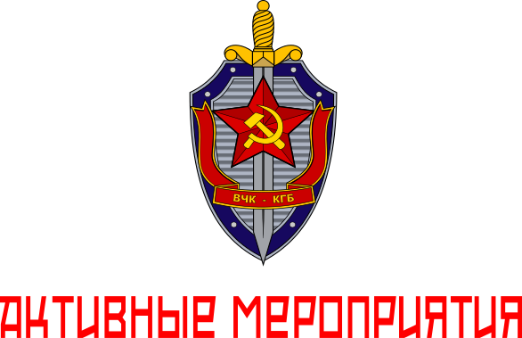

# Active Measure — Manuali

Repository dedicata ai manuali del Chamber LARP/EDU LARP/Serious Game **Active Measure**.

## Documentazione

Consulta i documenti disponibili in questa cartella per trovare le istruzioni e le informazioni relative ad Active Measure. Segui le indicazioni riportate nei singoli documenti e verifica di utilizzare la versione più recente.

## Aggiornamenti

Quando aggiorni un manuale, mantieni le istruzioni chiare e coerenti con il materiale di riferimento presente nel repository.

## Descrizione generale del LARP

«Quelli sono come una tribù. Parlano una loro lingua. Non basta avvicinarla quella gente.
Tu devi andare dove vanno loro, stargli attaccato al culo, entrare nelle loro teste... Parlare come parlano loro»
Angelo Pappas, Point Break, 1991

„Die Grenzen meiner Sprache bedeuten die Grenzen meiner Welt“ (in italiano: «I limiti del mio linguaggio significano i limiti del mio mondo») è la proposizione 5.6 del Tractatus Logico-Philosophicus (1921) del filosofo austriaco Ludwig Wittgenstein

La mia originale idea sull'attivitá della disinformazione sovietica negli anni della guerra fredda si è trasformata in una sorta di Chambers LARP o larp da camera che è anche una sorta di serious games. Lo scopo è quello di mettere in conflitto ideologico, e non solo, due fazioni con una regia centrale capace di fare da giudice e facilitatore. Ma il gioco dal vivo non finisce soltanto in questo modo perché la fazione URSS non tenterà soltanto di "convincere" la fazione USA verso una tesi screditante, dovrà cercare di usare i personaggi USA per fare in modo che essi stessi siano agenti influenza capaci di condizionare gli altri giocatori della stessa fazione e quindi in ultima istanza l' opinione pubblica USA.

I "lungo" PDF è fatto dal manuale principale del LARP che è per ovviamente gli organizzatori del LARP. Un manuale direi teorico/ideologico per il ruolo generale del KGB che può essere anche ricoperto da un master/facilitatore. Un manuale operativo per il ruolo colonnello del KGB che può essere anche letto dal generale del KGB. Ogni ruolo è sia per uomini che per donne. Tranne il ruolo del generale che è soltanto per esseri umani di sesso maschile. Non è per alzare qualche polemica ma è per far capire la sottile misoginia dell'epoca che vedeva si molti ruoli anche importanti nell'URSS ricoperti da donne, ma non i ruoli più importanti che erano per lo più maschili. La scelta storica è ovviamente voluta proprio per denunciare questa realtà. Da ultimo un manuale più breve per il ruolo di FBI della fazione USA che può essere anche ricoperto da un ulteriore master/facilitatore. Si gioca 5 contro 5 giocatori. 3 ruoli sono perfettamente speculari e sono quello di un giornalista, di un virologo ed di un diplomatico.

Tutto il gioco è volutamente asimmetrico e non bilanciato ed è voluto. Questo per ricalcare storicamente e filologicamente il ruolo dell'URSS di attaccante e degli USA diciamo difensivo ed in svantaggio. Svantaggio che è stato sopperito con scelte politiche/militari che esulano completamente da quanto simulato/giocato nel LARP.

Vi è molto da leggere e capire perchè il mio intento era cercare di insegnare la modalità di pensiero sovietica dell'epoca. Non si deve solo giocare immaginando di ricalcare una sorta di archetipo o figura magari televisiva dei diversi personaggi. No, si deve pensare od almeno cercare di pensare come i sovietici agivano all'epoca che è una modalità a noi estranea, ma che ha una sua consistenza logica nel contesto storico, geografico e politico dell'epoca. Questo è molto importante ed è il vero cuore pulsante dell'intero gioco. Può ovviamente non piacere ed è anzi un qualcosa che molti giocatori odieranno, ma il mio intento è quello di incuriosire coloro che veramente vogliono entrare nel teatro delle mente di un personaggio in un preciso momento storico particolarmente critico. Perchè agivano in questo modo? Perchè hanno spesso enormi risorse in tempo, denaro e personale in queste operazioni? Active Measure cerca di dare una risposta a tutto questo! 

Buona lettura e buon gioco.
